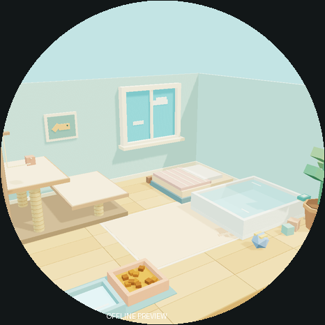
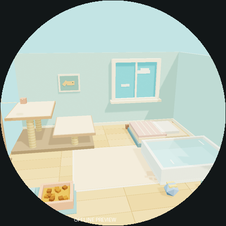
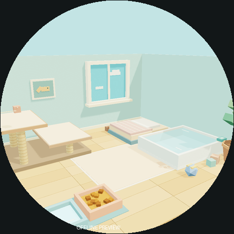

# 原房间离线底图：可选后续增强

**不属于当前吧唧参考还原。** 用户最新要求优先复原原HTML，原吧唧主屏保持黑底；此组房间仅保留为备选。没有注册到固件，没有默认`room.png`，没有设备构建/刷写。动画猫由独立原PCAT资产叠加，本目录背景没有猫。

## 三种取景（非真机）

| 样片 | 取景 | 原home脚底投影/466 | 说明 |
|---|---|---|---|
| A original-three-quarter | 相机(31,30,−47)，target(0,11,1)，FOV48° | (251.79,330.77) | 三分之四角度；食水盆位于前景、窗/床/爬架/浴盆清楚 |
| B front-room | (8,27,−47)，target(0,11,1.5)，FOV52° | (239.89,342.30) | 接近原portrait房间方向；中心地毯较开阔，爬架和前景食水盆靠圆边 |
| C close-three-quarter | (28,25,−42)，target(0,10,1)，FOV52° | (252.68,326.11) | 更低更近的三分之四角度；窗/浴盆较大，前景圆边裁切更多 |





每种有：

- `*-233.png`：233×233、不透明RGB，无猫，供后续低内存底图候选。
- `*-233-rgb565le.raw`：行优先、无文件头、233×233×2=108578字节；RGB565，小端字节序。
- `*-466-circle-preview.png`：466×466圆形遮罩预览，圆外深色并标OFFLINE PREVIEW，不是设备截图。
- `*-full.png`：932×932离线高分辨率图。

233原图保留完整方形画面；圆边裁切只出现在预览中。若将来叠192×208原猫，建议先试466坐标(137,142)的虚拟sprite框、脚底约350px；这只是合成建议元数据，背景内没有画猫或占位轮廓，原home投影与该虚拟锚点分别记录，不把两者混称同一原场景坐标。

## 真实来源与提取边界

- 源：`小橘电子宠物.html`；SHA-256 `3e1b68b6dcef89ce6003961e0abb41354785443bd0427b83ed70f7589fd8af53`。
- 从包含`async function bf`的inline script提取真实构造语句：①bf开始至`let z=await Ss()`前；②`let j=[`起至`let $e=new ut;`前。第二段包含真实爬架与浴盆，不能漏掉。
- 复用原Three核心数学/几何/材料类；WebGLRenderer与OrbitControls仅替换为数据shim，得到原Mesh、三角索引、顶点法线、材料linear颜色、worldMatrix与原灯光。没有执行整份HTML、App bootstrap、Ss猫加载器、RAF、DOM交互、浏览器或网络。
- 导出**173个可见Mesh、2754个三角面、3盏原灯光**。包括原地板/两墙/窗框/床/毯子/食盆与食粒/水盆/植物/玩具/画框/爬架/浴盆和原水面；原隐藏的猫互动特效不导出。
- 数据shim若遇DOM访问即抛错；不靠代理浏览器/HTTP/CDP绕过参考文件查看限制。

## 渲染方式与限制

Python NumPy做三角深度缓冲、透视校正插值、法线变换、正面剔除、透明混合和原方向光的3×3 PCF深度阴影；保留原三盏灯颜色/位置/强度，原exposure1.22。MeshStandard以Lambert/π和拟合ACES近似，MeshBasic不受灯光照射，最后转sRGB。

**它不是精确Three.js WebGL/PBR截图。** 没有镜面反射、环境贴图、WebGL阴影内核、运行时动态水纹或猫的接触阴影。所有可见房间几何来自原源文件，没有AI重画、手绘SVG/CSS家具或带猫截图抹除。取景/光照差异和圆屏实际可读性仍须未来整合后验收。

原相机参数、灯光、脚底投影、source切块偏移、几何计数、生成工具/几何/输出hash及runtime版本见`provenance.json`；原始导出数据见`original-room-scene.json`。

## 可复现命令

在项目根，使用已有Node/Python/NumPy/Pillow：

```sh
node firmware/tools/render_original_room.mjs
python3 firmware/tools/render_original_room.py
```

默认不选任何样片、不注册固件。只有后续明确决定采用某个底图时才可用`--select <camera-name>`生成`room.png`/`room-rgb565le.raw`；当前没有执行该选择。其余agent的猫帧、注册表、固件main、Android与JS生成器均未修改。
