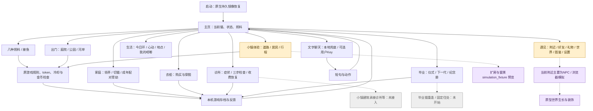
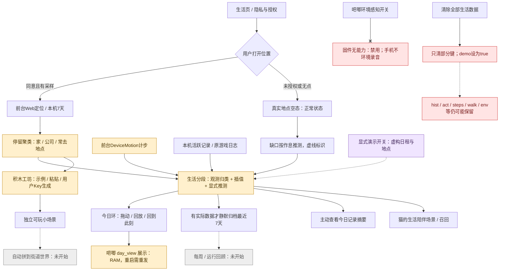
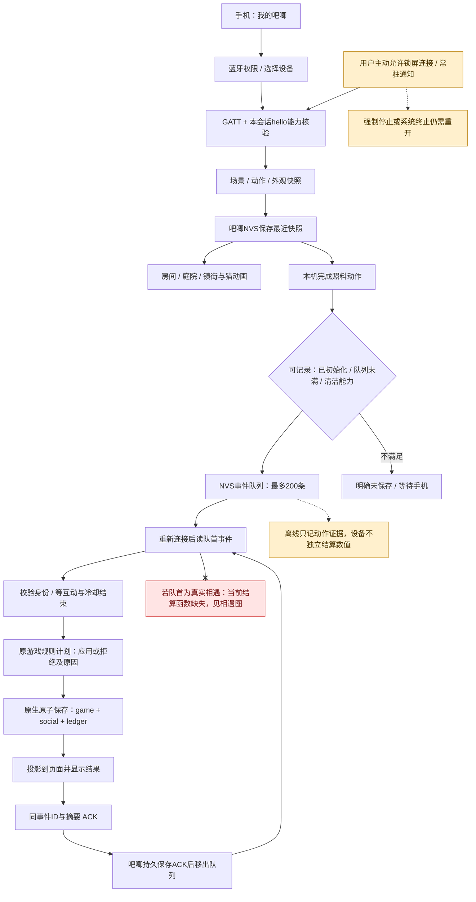
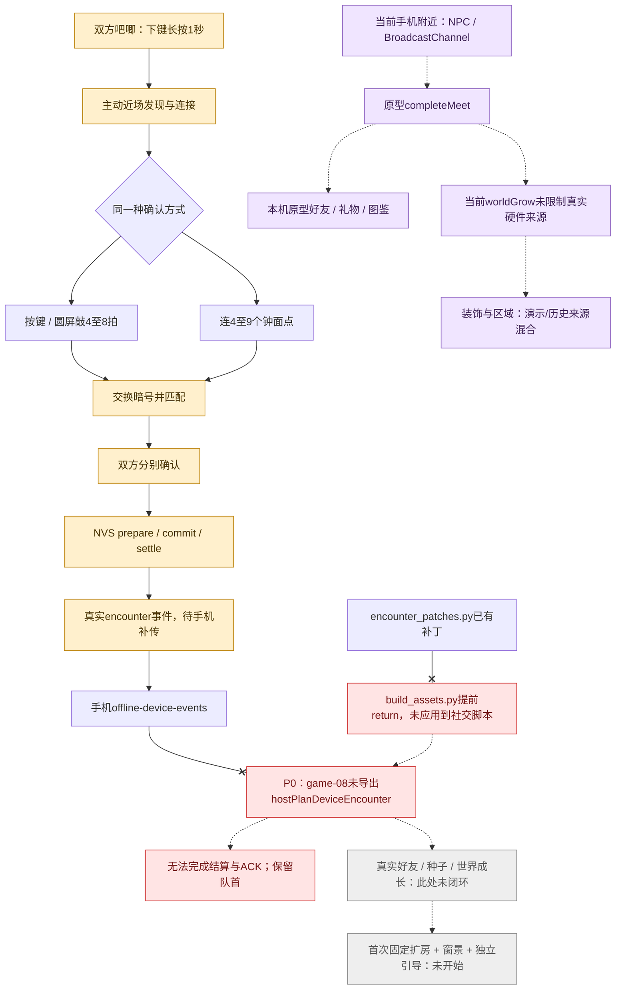

# 猫咪森活功能盘点｜2026-10-19

本次是静态实现审计，不是测试或验收。已读取原 Notion PRD、当前集成源码、打包脚本、Android资产及053 APK内脚本。没有启动应用、运行单元测试/lint/模拟交互、调用AI服务、安装/烧录、改应用源码或执行Git写操作。最新授权允许将审计文字与图表写入原PRD下的新子页面；没有上传或共享本地文件。

审计版本：手机 `0.5.3-scene-expansion` / versionCode 44；吧唧 `0.7.1-scene-expansion`。工作树已有大量集成未提交改动，本次保留。历史根README与PRD的0.3.4/049封版仅作历史，不能覆盖当前代码。

原PRD：[拓麻歌子](https://app.notion.com/p/dabc209ad67f8338af9101d5810f7160)，Notion MCP读取成功，page_last_edited_at为2026-10-19T05:42:38.458Z；返回未提供truncated/unknown_block_count字段。已核对3–8章及13.1、13.9–13.14等相关内容；附件内的完整旧原型与关联文档未逐一远程读取，当前仓库打包资产作为实际实现依据。

## 关键结论

1. **P0：真实相遇结算断在手机打包接入。** `offline-device-events.js:171`调用`__pgSocial.hostPlanDeviceEncounter`，当前053 APK和Android资产的game-08均没有该函数。构建脚本186–187行对社交脚本提前返回，206行才调用相遇补丁；补丁文件和helper存在不等于接入。预计真实相遇事件不能完成计划/ACK，FIFO队首还可能阻住后续照料。没有执行复现。
2. **P0：当前手机“附近”仍是原型。** NPC、BroadcastChannel双窗口、已取消的手机扫码/Fate入口仍在053包。原型completeMeet直接调用无来源限制的worldGrow，NPC也可触发世界生长，违背PRD“成功真实相遇才生长”的当前边界。
3. **手机多数养成页面有实际业务链。** 主页照料、家庭领养/成年配对、衣柜、接鱼、诊疗、毕业、手记、今日环手动导航有入口、处理器、规则和存储，不能统称占位。此类标“完整实现但待实机确认”，不外推验收。
4. **明确占位/演示集中于环境感知、吧唧语音、手机附近社交原型、Fate和扩房窗景预览。** 常去地点无数据的空态、没好友/没礼物的空列表、未来环没有已发生事件，是正常状态；不以空状态判占位。
5. **P1：生活清除不完整且会回到演示。** 清除handler只删部分键，未清hist/act/steps/walk/env；未停止motion，并将demo设true。行动点领取也先写claim再结算、忽略结果仍报成功。这两条是静态可见缺口。
6. **离线照料是“记动作—连手机按原规则结算”。** 吧唧已有NVS快照和200条事件队列、手机原子结果/去重/ACK；设备不独立推进完整数值养成或离线下降。清洁能力在重启后需重新协商；设备今日环只存RAM。
7. **新体验仍缺整链。** 首次真实相遇固定扩房+窗景+独立引导、生活小场景自动拼街道、建筑接功能、毕业猫重逢住处、回忆陈列/来源、每周/远行回顾均未发现完整生产入口或链路。
8. **存档范围有进展但不完整。** 已包含社交世界/布局、设备去重与未知命令、毕业照片；生活轨迹/心动/历史、工坊配方、聊天摘要等不在当前完整备份元数据中。
9. **用户确认严格保留版本边界。** 052/070床/吊球/花蝶互动基本可用，068配色及较早连接/滑动曾被确认；053/071扩大1.35后的比例与动作落点待验。相遇仍有问题；小镇引导被切回自由及无限互动未解决且用户已暂停治理。鲨鱼衣服是独立资产，未接入。

## 分类与优先级

- **完整实现但待实机确认**：在审计的限定功能切片内找到可达入口、处理器、规则/数据和结果保存，未发现明确静态断点。不是正式生产或实机通过声明。
- **用户已确认基本可用**：仅采用本次委派明确传达的用户反馈，保留其版本/范围边界。
- **部分实现**：链路有实际代码，但存在断点、缺生产来源、能力覆盖不足或明确未解决反馈。
- **纯占位/演示**：当前能力只有说明/Toast/禁用入口，或以固定/模拟源展示目标能力。正常游戏规则目录与普通空态不因此归类。
- **未开始**：对应新增方向在当前入口/相关实现模块未发现接入；不证明仓库外绝无实验。
- **无法核实**：需要当前实机/外设/双机或运行证据，本次授权范围内无法确认。

P0：阻断目标链路或混淆真实数据；P1：基础体验/存储/隐私/本版验收；P2：后续完整体验；P3：更后阶段服务。优先级是本次审计建议，不是已获准实施排期。

71个审计条目：完整实现但待实机确认23，用户已确认基本可用3，部分实现28，纯占位/演示8，未开始8，无法核实1。条目为功能切片，**不计算PRD完成百分比**。

## 入口、数据与存储总览

| 入口/层 | 当前实际数据 | 结果与存储 |
| --- | --- | --- |
| 主页/照料/家庭/衣柜/诊所/毕业/出门 | 原游戏store、固定规则目录、用户操作 | pixel-cat-pet-v1；journal最近30条；毕业照片独立键 |
| 今日生活 | 前台地理/运动、本机活跃/游戏记录、规则归类/插值/显式推测；可选演示源 | pg-life-*；7天原始位置/历史规则；不等同于完整备份 |
| AI文字 | 五维性格+最近最多8条摘要；规则兜底或可选用户Key云端 | 本机有界聊天摘要；Key由AndroidKeyStore加密；不产生资产奖励 |
| 积木工坊 | 固定示例/手贴配方/可选AI生成 | pg_bk_v1；另有pg_bk_key浏览器存储 |
| 相遇页 | 当前仍为NPC与同浏览器BroadcastChannel原型；真实收据另走消费器 | pg-social-v1，含好友/礼物/图鉴/世界/布局；真实encounter接入断点 |
| 手机—吧唧 | 原生扫描/GATT/同会话能力、快照、设备事件 | 身份/journal/ledger+原生AtomicFile；吧唧cf_local2 NVS |
| 吧唧独立显示 | 最近持久快照、RAM日程与场景动画、离线动作证据 | NVS最多200事件、32对端；完整养成数值等手机结算 |

功能按钮追踪结论：喂食/衣柜/领养/配对/诊疗/毕业/小游戏等均有处理器；“仅Toast/说明”的关键项为吧唧语音设置、固件同步说明、手机原型举报完成提示及无能力感知。真实相遇补丁/helper属于存在但当前未注入的不可达实现；环境感知旧分类函数/历史数据/间隔选项仍可见，但采集函数已硬禁用。

## 交互流程图

图例：**实线表示静态代码存在调用与数据处理路径，包含的闭环仅是代码闭环，不等于真机通过。虚线表示演示、预览或尚未接入的方向；红框/叉线表示明确断点；橙框表示部分实现或待验；紫框为演示；灰框为未开始。** 逐条验收状态以清单为准。

### 01-phone-navigation

### 02-life-data-flow

### 03-care-and-offline-sync

### 04-encounters-and-world

## 逐页逐功能清单

## 主页

### H01 启动、原生恢复与加载

**分类：完整实现但待实机确认｜P1**

实际能做：原生持久镜像恢复后顺序装载原游戏及增强脚本；异常显示恢复入口。

缺口/边界：只证明静态恢复路径齐全，未验证当前启动、损坏存档与后台恢复。

依赖：Android WebView、EventDurableBridge、原生本机文件。

证据：`app/web/offline-durable-store.js:111–129；app/preview/index.html:745`。

### H02 手机导航、抽屉与返回

**分类：完整实现但待实机确认｜P1**

实际能做：底栏进入出门/衣柜/家庭/诊所/手记；生活/遇见/小镇/聊天动态加入口；系统返回逐层关闭。

缺口/边界：短屏、遮挡和返回层级未实机复验。

依赖：game-04 抽屉及 offline-host 返回所有权。

证据：`app/preview/index.html:244–265；app/preview/game-04.js:18–69；app/web/offline-host.js:162–177`。

### H03 八种照料及数值结算

**分类：完整实现但待实机确认｜P1**

实际能做：喂食、喝水、洗澡、爬架、逗猫、摸摸、接鱼、睡觉；互动完成后按规则收费、成长及保存；有冷却/忙碌/金币拦截。

缺口/边界：每种操作及失败分支尚未逐一实机确认；不能据动画完成认定结算通过。

依赖：原游戏 store，WebStorage；设备事件另走原子事务。

证据：`app/preview/index.html:189–196；app/preview/game-03.js:1、30、4200（tu/beginCare/finishCare/act）`。

### H04 床与吊球动作

**分类：用户已确认基本可用｜P1**

实际能做：点床走近并上床侧卧；点吊球走爬架并扑球。

缺口/边界：用户确认的是052/070互动基本可用；053/071改布局后仍待回归，不外推全部照料。

依赖：既有床/吊球动作、原照料结算。

证据：`本次委派中的用户验收边界；app/web/offline-room-bed.js:1–72；app/preview/game-03.js:4186、4200；deliverables/2026-10-19/cat-scene-expansion/DELIVERY-AND-ACCEPTANCE.md:5–7、23–27`。

### H05 房间与庭院扩大1.35

**分类：部分实现｜P1**

实际能做：两端共用布局配置，扩大X/Z几何与交互锚点，保留猫大小。

缺口/边界：053/071比例、裁切、动作落点待用户验收；这是全局布局扩大，不是真实相遇扩建。

依赖：protocol/scene-layout-v1.json；手机和固件生成布局。

证据：`protocol/scene-layout-v1.json:1；app/web/scene-layout.js:1–2；firmware/main/scene_layout.generated.h:1；场景扩展交付文档:5–7、21–27`。

### H06 状态、成长、愿望与印章

**分类：完整实现但待实机确认｜P1**

实际能做：显示饱腹/心情/清洁/精力/健康、喵币与阶段；规则达成后领取愿望奖励和印章。

缺口/边界：愿望仍为固定规则目录；与熟人/真实地点关联的新愿望未接入。

依赖：原游戏 counts/xp/claimedGoals。

证据：`app/preview/index.html:215–225；app/preview/game-03.js:1（zo）、30（_e）`。

### H07 接鱼小游戏

**分类：完整实现但待实机确认｜P2**

实际能做：20秒左右移动接鱼，成绩交给 finishPlay 结算，取消不奖励。

缺口/边界：输入、难度、成绩有效性及断开恢复待实机确认。

依赖：原游戏小游戏 token 与成长规则。

证据：`app/preview/index.html:232；app/preview/game-03.js:4200（onFinish、finishPlay）`。

## 家庭

### F01 领养与多猫切换

**分类：完整实现但待实机确认｜P1**

实际能做：预览品种，输入名字/性别，12币领养幼猫；最多6只且为待生幼猫预留位置；切换当前猫。

缺口/边界：当前静态已隐藏重复品种下拉和衣柜品种入口；布局未实机复验。

依赖：adoptCat/switchCat、家庭存档。

证据：`app/web/offline-family-ui.js:5–36；app/preview/game-03.js:30（$e、it）；4200（表单处理器）`。

### F02 成年配对、育幼与出生

**分类：完整实现但待实机确认｜P1**

实际能做：成年且健康时花30币与NPC伙伴配对；3次照料和60秒活跃陪伴后领取幼猫；支持取消。

缺口/边界：“成年后陪伴”实际为配对育幼，并非新照料/毕业功能；真人联机蛋另属原型。

依赖：beginFamily/advanceFamily/claimBaby；家庭容量及健康。

证据：`app/web/offline-family-ui.js:37–42；app/preview/game-03.js:30（X、R、x）`。

## 衣柜

### W01 购买、穿脱与家庭共享

**分类：完整实现但待实机确认｜P1**

实际能做：用喵币买已有服饰，家庭共享衣柜；装备或脱下并刷新模型；品种改到领养预览。

缺口/边界：各件服装各场景贴合待验；馈赠限定仍依赖原型/真实礼物链路；无真实支付。

依赖：buyItem/equipItem；原 wardrobe。

证据：`app/web/offline-family-ui.js:8–14；app/preview/game-03.js:4200（outfit-list）；app/web/native-cat-legacy-outfits.js:1–16`。

### W02 吧唧服饰与双端外观

**分类：部分实现｜P1**

实际能做：同步品种/成长/体型请求/服饰；固件明确支持无服饰、蝴蝶结、三角巾（bandana）、背包、翅膀。

缺口/边界：手机可选服饰多于吧唧可渲染集；协议识别不等于都有素材；颜色/贴合需回归。

依赖：pet-appearance、scene_places/appearance 能力及固件帧资产。

证据：`app/web/pet-appearance.js:4–15；firmware/main/badge_appearance.c:11–36；firmware/main/badge_pages.c:1635–1661`。

### W03 鲨鱼衣服

**分类：未开始｜P2**

实际能做：已有独立资产信息。

缺口/边界：未接入手机衣柜、角色模型或吧唧支持目录。

依赖：资产替换与接入另行授权。

证据：`本次委派明确：鲨鱼衣服独立资产未接入；app/web/pet-appearance.js:5；firmware/main/badge_appearance.c:15`。

## 成长体型

### G01 年龄阶段驱动模型

**分类：完整实现但待实机确认｜P1**

实际能做：幼猫/少年/成年使用不同模型与比例；手机和吧唧均接成长阶段。

缺口/边界：阶段切换可感知程度与各场景一致性待验；不能沿用旧0.3.4无变化结论。

依赖：xp阶段、native-cat模型与固件成长资产。

证据：`app/web/pet-growth.js:4–15；app/web/native-cat-model.js:87–101、134–143；app/web/pet-appearance.js:8–12`。

### G02 成年胖瘦

**分类：部分实现｜P2**

实际能做：渲染器可接收slim/standard/round并选择资产，幼猫和少年保持标准体型。

缺口/边界：未发现随饮食/活动演化胖瘦的生产规则或用户设置入口；字段/素材并不构成完整体型养成。

依赖：原游戏体型字段、规则设计、资产。

证据：`app/web/pet-appearance.js:6、10–15；app/web/native-cat-model.js:92、139；firmware/main/local2_core.h:34`。

## 今日生活环

### L01 手动拨动、回放、未来与此刻

**分类：完整实现但待实机确认｜P1**

实际能做：拖动圆环定位时间、左右键15分钟切换、回到此刻、回放；未来不借用已发生事件。

缺口/边界：当前触摸、重绘保持选区、关闭清理和吧唧联动需实机确认。

依赖：life-v5 hostSelectDayTime与life-navigation。

证据：`app/web/life-navigation.js:20–29、49–79；app/preview/game-06.js:688–733、865–873`。

### L03 演示日程与推测日程

**分类：纯占位/演示｜P1**

实际能做：显式演示模式提供固定虚构地点、可复现的一天及历史环；普通模式缺口按作息推测并标虚线。

缺口/边界：演示仍为正式入口可选项；无定位时的完整环不是真实轨迹；旧演示配置会保留。

依赖：pg-life-cfg、demoDay、autoDay。

证据：`app/preview/game-06.js:408、429–458、516–540、553；普通空态见L02`。

### L07 心动轨迹与怪行为

**分类：完整实现但待实机确认｜P2**

实际能做：从照料/怪行为收集本机时刻，图表与列表回看；怪行为有条件、动作及反馈。

缺口/边界：演示模式会添虚构心动并标演示；环境历史不代表新固件观测。

依赖：pg-life-moments、怪行为目录。

证据：`app/preview/game-06.js:153–267、562–591、826–831；app/preview/game-08.js:33–69`。

### L08 生活行动点领取

**分类：部分实现｜P1**

实际能做：汇总生活行动点，可换心情/喵币，每日标记一次。

缺口/边界：handler先保存claim标记，再调用lifeLog且忽略返回/异常仍Toast成功；失败时是否失去领取机会未验证。

依赖：可确认生活来源、原游戏写入成功回执。

证据：`app/preview/game-06.js:956–959；app/preview/game-03.js:30（lifeLog）`。

### L09 随生活外出、回家与明信片

**分类：部分实现｜P1**

实际能做：按生活段让猫处于外出显示；可召回30分钟；卡片显示对应地点/场景并通知双端。

缺口/边界：大部分为程序化陪伴画面；未见完整持久明信片藏品和来源陈列；推测段不可说成实际共同出游。

依赖：life同步开关、可信地点、hostAppliedCompanion。

证据：`app/preview/game-06.js:982–999；app/web/life-summary.inc.js:1–14；app/web/offline-scene-map.js:68–85`。

## 地点与感知

### L02 真实位置采样、地点聚类与空态

**分类：部分实现｜P1**

实际能做：用户授权后前台Web定位；本机保留7天；按停留聚类家/公司/常去地点；没有真实数据时显示空态。

缺口/边界：家/公司来自时间规则推断；尚无后台生活定位，准确性和两访固定地点条件待验；不能把空态判占位。

依赖：位置权限、WebView地理桥、真实样本。

证据：`app/preview/game-06.js:460–495、833–839；app/android/app/src/main/java/com/catforest/htmlcandidate/MainActivity.java:178–184；AndroidManifest.xml:14–15`。

### L04 运动计步

**分类：部分实现｜P1**

实际能做：前台DeviceMotion阈值计步，保存每日步数/步行段并供生活环读取。

缺口/边界：未见系统计步/健康平台或后台采集；有simSteps注入接口；实际设备传感可用性与误差未核实。

依赖：运动传感器、用户开关、Web事件。

证据：`app/preview/game-08.js:8–31；app/preview/game-06.js:517、522、846`。

### L05 吧唧环境感知

**分类：纯占位/演示｜P2**

实际能做：显示能力不可用说明，保留旧历史；开关禁用；手机listen立即返回失败。

缺口/边界：无吧唧环境传感生产来源，当前无法采集/生成新环境记录；这是诚实占位。

依赖：吧唧麦克风、明确能力协商、独立授权和状态提示。

证据：`app/preview/game-08.js:33–69；app/preview/game-06.js:848；app/scripts/build_assets.py:165–175`。

### L06 按住说话与快捷短句

**分类：部分实现｜P2**

实际能做：手机主动按住走Web Speech或麦克风音量兜底，快捷短句走规则回应；离开会取消采集。

缺口/边界：不是吧唧离线语音或AI语义理解；音量兜底不代表识别；权限/识别源和当前机型需验。

依赖：RECORD_AUDIO、WebView媒体桥；用户voice开关。

证据：`app/preview/game-06.js:922–952、971–973；app/android/app/src/main/java/com/catforest/htmlcandidate/MainActivity.java:214–224；AndroidManifest.xml:13`。

## 回顾

### L10 最近7天圆环与今日记录摘要

**分类：部分实现｜P1**

实际能做：有实际数据才静默归档最近7天，可打开历史环和摘要；摘要剔除显式guess/demo。

缺口/边界：同地缺口小于240分钟的插值和夜间睡眠推定没有另置guess，摘要只过滤guess仍会计作确认记录；真实/推测边界需治理；这不是每周/旅行回顾。

依赖：pg-life-hist、真实/推测标记。

证据：`app/preview/game-06.js:502–559、770–782；app/web/life-summary.inc.js:3–13`。

### L11 每周与远行后回顾

**分类：未开始｜P2**

实际能做：保留日常圆环和记录查看。

缺口/边界：未找到新回顾入口、周触发、旅行判定、去重及真实内容整合；PRD方向尚待设计。

依赖：PRD13.11；常驻地与远行阈值、真实记录。

证据：`Notion PRD13.11；app/preview/game-06.js:814–825（当前只有主动查看今日摘要与历史环）；app/web/life-summary.inc.js:1–14`。

## 设置

### L12 清除全部生活数据

**分类：部分实现｜P1**

实际能做：按钮清定位数组及mom/names/claim/cfg的存储键。

缺口/边界：未清hist/act/steps/walk/env等；motion未停止、内存mom/names仍可能保留；cfg.demo被设true，清除后出现虚构数据；文案范围与实际不符。

依赖：统一生活存储清除与各传感停止机制。

证据：`app/preview/game-06.js:405、437、476、498、543、960；app/preview/game-08.js:9、24、33`。

### E11 社交发现、音振、范围、拉黑与举报

**分类：部分实现｜P1**

实际能做：本机保存社交偏好、拉黑列表与举报文本；控制NPC/浏览器原型提示。

缺口/边界：“可被发现/吧唧提示音”等手机文案不等于配置真实吧唧；举报仅本机，Toast称正式版24小时处理；无服务端受理。

依赖：真实设置协议或明确原型文案；正式举报服务。

证据：`app/preview/game-08.js:855–873、883–895；app/scripts/encounter_patches.py:65–72`。

### S03 改名、新养成与体验数据导出

**分类：完整实现但待实机确认｜P2**

实际能做：改名2–12字；新养成二次确认重建原游戏家庭；导出本机体验事件/受试编号/摘要。

缺口/边界：重开养成不是清除全部生活/社交隐私；体验埋点不等于真实留存分析或三周试养完成。

依赖：原游戏reset/rename；analytics本地队列。

证据：`app/preview/index.html:164–168、231、233；app/preview/game-03.js:30、4200；app/preview/game-04.js:108–198`。

## AI小猫

### A01 文字聊天本地陪伴

**分类：完整实现但待实机确认｜P2**

实际能做：可输入文本，规则短句兜底并做look/sniff/paw/yawn等动作；不改变喵币和成长。

缺口/边界：本地短句不是大模型回复；表现与原动作共存待验。

依赖：cat-dialogue UI、原性格五维。

证据：`app/web/cat-dialogue.js:9–19、22–24`。

### A02 用户Key云端回复

**分类：完整实现但待实机确认｜P1**

实际能做：明确同意后保存用户Key至AndroidKeyStore加密文件；只发本次文本/五维性格/最多8条摘要，调用step-3.5-flash；停用/移除/异常兜底。

缺口/边界：未进行网络调用，不确认Key、配额、延迟或模型当前服务可用；使用为可选。

依赖：用户Key/授权/网络；CatDialogueBridge。

证据：`app/web/cat-dialogue.js:11–19；app/android/app/src/main/java/com/catforest/htmlcandidate/CatDialogueBridge.java:53–85`。

### A03 人格与长期记忆

**分类：部分实现｜P2**

实际能做：原五维性格、最近成功照料/户外/硬件收据摘要可作为聊天背景。

缺口/边界：有界摘要不是完整长期记忆；未见完整聊天历史、记忆检索、跨代人格传承模型；本地聊天记忆不在当前备份范围。

依赖：身份绑定、真实事件、长期记忆与备份设计。

证据：`app/web/cat-dialogue.js:4–8、20–21；app/web/offline-event-store.js:24–28；Notion PRD8.7、13.11`。

## 外出小场景

### O01 庭院/公园/河岸及三种活动

**分类：完整实现但待实机确认｜P1**

实际能做：切庭院/公园/河岸，探索采集/牵猫散步/钓鱼，口袋出售及委托完成后结算。

缺口/边界：当前实际走位/桥梁/遮挡需验；原庭院与小镇外围庭院不是同一个入口。

依赖：beginWorldActivity/collect/applyChoice/settle。

证据：`app/preview/index.html:199；app/preview/game-03.js:30、4200；app/web/town-integration.js:22、40`。

### O02 脚本偶遇与疾病事件

**分类：完整实现但待实机确认｜P2**

实际能做：雨、蝴蝶、纸袋等固定目录触发选择、演出和原规则后果；可影响物品/成长/健康。

缺口/边界：固定游戏事件是正常玩法，不是实际天气/真实社交；雪没有生产天气来源。

依赖：原世界事件目录、choice token。

证据：`app/preview/game-03.js:1、30、4200；app/web/town-player-runtime.inc.js:281–316；app/web/offline-scene-map.js:14–15`。

### O03 真实常去地点变成小场景

**分类：部分实现｜P2**

实际能做：地点卡片可跳转到已有基础场景；组件工坊按地点读配方或示例配方。

缺口/边界：真实定位点不等于真实建筑；未见达到两访后自动生成并持久复用的完整自动任务。

依赖：固定地点识别、配方生成、合法组件与持久化。

证据：`app/preview/game-06.js:1010–1018；app/preview/game-07.js:304–312、338–340`。

### O04 积木工坊

**分类：部分实现｜P1**

实际能做：示例配方、粘贴JSON、组件库、校验/应用/删除；自填Key可请求AI生成配方。

缺口/边界：本机WebStorage配方/Key与聊天原生加密Key是两套；可记住Key为浏览器明文键；无当前网络可用证据；不含新GLB家具接入。

依赖：pg_bk_v1、pg_bk_key、StepFun网络与组件库。

证据：`app/preview/game-07.js:81–138、225–232、301–307、325–393；Notion PRD13.7`。

## 小镇

### T01 原小镇进入、行走、行程与结算

**分类：部分实现｜P1**

实际能做：独立小镇入口复用自己的猫、道路/桥梁/跟随相机、散步路标、庭院往返与原规则结算。

缺口/边界：用户反馈引导切回自由和无限互动未解决，已暂停治理；代码虽有取消/超时/避让仍不可判修复；桥梁/遮挡当前未复验。

依赖：原小镇模型、TownPlayer与原store。

证据：`app/web/town-integration.js:7–44、48–59；app/web/town-player-runtime.inc.js:202–218、319–331；本次委派验收边界`。

### T02 居民互动

**分类：部分实现｜P1**

实际能做：点击居民靠近，闻花/陪玩/结束；接触状态机有冷却/分离/超时；外围庭院有闻花追蝶。

缺口/边界：用户报告循环互动尚未通过；居民主要固定资料与对白；缺生活小场景来访—故乡—未来重逢的持久叙事链。

依赖：TownContact、TownPlayer；真实关系记录。

证据：`app/web/town-contact-runtime.inc.js:1–85；app/web/town-player-runtime.inc.js:188–200、234–256；Notion PRD13.11`。

### T03 功能建筑承接医院/衣柜/家庭

**分类：未开始｜P2**

实际能做：建筑可作为小镇景观。

缺口/边界：当前小镇click处理未见建筑进入后打开这些业务页的对应链路；快捷入口独立存在。

依赖：建筑映射、进入/退出与原业务路由。

证据：`app/web/town-player-runtime.inc.js:266–280、328；app/web/original-town-runtime.js:2885；Notion PRD13.11`。

### T04 扩房与窗外小镇预览

**分类：纯占位/演示｜P2**

实际能做：小镇菜单可预览变大的房间与街景，点结束恢复。

缺口/边界：明确以simulation_fixture直接applyGrowth，不消耗种子/不落真实成长；不能当首次相遇完成。

依赖：CatWorldRenderer、临时相机/截屏。

证据：`app/web/town-integration.js:61–78；app/web/offline-world-renderer.js:1–175`。

### T05 街道世界自动拼接生活场景

**分类：未开始｜P2**

实际能做：保留原小镇与独立生活场景。

缺口/边界：未见相遇扩展空间与生活地点内容自动接入外围道路、持久槽位及恢复算法。

依赖：PRD13.10；相遇可信链路、空间规则。

证据：`Notion PRD13.10；app/web/town-integration.js:26–27、61–75；app/preview/game-07.js:304–312`。

## 医院

### C01 检查—收费—恢复

**分类：完整实现但待实机确认｜P1**

实际能做：轻感冒/肠胃不适或健康体检；体温/听诊/护理三步完成才收费；中途离开取消，诊疗8币/体检4币。

缺口/边界：不能因小镇没医院路由说疾病系统未开始；动作及实际症状反馈待验。

依赖：beginVisit/finishVisit/cancelVisit及健康规则。

证据：`app/preview/index.html:201、235；app/preview/game-03.js:30、4200；app/web/clinic-feedback.inc.js:1–29`。

### C02 完整症状演出与建筑就诊

**分类：部分实现｜P2**

实际能做：现有病种和准确检查/恢复文案已接入。

缺口/边界：持续可识别的症状动画、医院建筑串联和恢复场景反馈仍不完整/未验。

依赖：现有疾病规则与小镇功能建筑。

证据：`app/web/clinic-feedback.inc.js:4–22；app/web/town-player-runtime.inc.js:266–280；Notion PRD13.11`。

## 毕业

### R01 毕业仪式、传承与纪念册

**分类：完整实现但待实机确认｜P1**

实际能做：满足规则或试养入口毕业，可延期一次；拍照/写信/给下一代取名；保存毕业身份与传承，再只读回看纪念册。

缺口/边界：仪式和延期、照片、恢复未实机逐项验；信为规则模板，不是AI完整记忆。

依赖：原graduate/postpone与pet-grad-photo、graduates记录。

证据：`app/preview/game-05.js:26–44、113–150、174–193；app/preview/game-03.js:30（__pgG、__pgP）`。

### R02 毕业猫重逢与固定住处探望

**分类：未开始｜P2**

实际能做：可回看纪念册中的毕业猫。

缺口/边界：未找到同一身份毕业猫在生活场景重逢、固定住处、探望与真实回忆呈现链。

依赖：毕业身份/回忆、NPC调度、住处设计。

证据：`Notion PRD13.11；app/preview/game-05.js:146–158；app/web/town-player-runtime.inc.js:234–256`。

## 手记

### M01 生活手记与纪念查看

**分类：完整实现但待实机确认｜P2**

实际能做：记录照料、穿衣、就医、出生、户外及毕业等真实游戏操作；相遇页有社交手记。

缺口/边界：原游戏手记仅最近30条，社交日志60条；不是完整永久回忆库。

依赖：原journal、social.log、毕业纪念资产。

证据：`app/preview/index.html:203；app/preview/game-03.js:1（journal.slice(-30)）；app/preview/game-08.js:153、817–828`。

## 回忆

### M02 物件来历、明信片/回忆陈列、关系愿望

**分类：未开始｜P2**

实际能做：已有固定愿望、手记、家具与毕业纪念册基础。

缺口/边界：未见物件来源全链、持久明信片藏品、家中陈列、熟人地点愿望；不能据装饰存在认定完成。

依赖：PRD13.11；可信相遇来源及纪念存储。

证据：`Notion PRD13.11；app/preview/game-03.js:1（zo）；app/preview/game-08.js:589–670；app/preview/game-06.js:990`。

## 相遇

### E01 手机附近雷达与扫码/双窗口试玩

**分类：纯占位/演示｜P0**

实际能做：固定NPC走近及BroadcastChannel模拟BLE；手机可敲节奏/连点/扫码/开第二玩家窗口。

缺口/边界：当前053 APK仍保留被取消的扫码用途和双窗口模拟；雷达不是真实BLE附近设备。

依赖：未生效的encounter_patches；真实吧唧入口替换。

证据：`app/android/app/src/main/assets/game-08.js:214–224、794–803、876–878；app/scripts/encounter_patches.py:15–17、44–47；APK静态证据见STATIC-EVIDENCE.md`。

### E02 吧唧按键/画图、双向确认

**分类：部分实现｜P1**

实际能做：下键长按1秒进入；4–8拍或4–9连点，交换输入/双向确认，prepare/commit/settle持久状态机；电源短按回家。

缺口/边界：用户明确相遇仍有问题未验；需两台真实设备验证；固件成功页不代表手机已建立好友。

依赖：两台吧唧、BLE近场、NVS、手机消费函数。

证据：`firmware/main/badge_keys.c:19–36；firmware/main/badge_pages.c:1443–1491；firmware/main/local2_peer.c:16–30、110–144；local2_core.c:201–221`。

### E03 真实相遇事件进入手机

**分类：部分实现｜P0**

实际能做：事件验证/持久事务框架支持encounter，消费器准备调用社交结算函数。

缺口/边界：P0断点：当前game-08无hostPlanDeviceEncounter，消费者171行直接调用；构建186–187提前返回，206行补丁仅落在game-03路径；收到事件将不能完成计划/ACK，队首也可能阻住后续照料。

依赖：修正打包接入后再做双机端到端确认；本次未修。

证据：`app/scripts/build_assets.py:185–206；app/scripts/encounter_patches.py:3、62–63；app/web/offline-device-events.js:52–54、118、171；APK game-08缺函数，见STATIC-EVIDENCE.md`。

### E09 Fate缘分擦肩

**分类：纯占位/演示｜P2**

实际能做：手机原型开关、倾斜/生成样本可演示大礼与世界区域。

缺口/边界：无完整吧唧后台晃动采集、对时与双机链路；默认关闭不能称完成；当前原型开关仍可开。

依赖：硬件IMU、独立授权、能耗与可信匹配。

证据：`app/preview/game-08.js:528–565、855–868；app/scripts/encounter_patches.py:17、23–27、55；Notion PRD13.10`。

## 相遇世界

### E04 种子、每天3–5次与装饰生长

**分类：纯占位/演示｜P0**

实际能做：当前原型completeMeet调用worldGrow，按主人ID+日期种子生成装饰/区域并可编辑位置。

缺口/边界：053包worldGrow不限制native_device，NPC/双窗口原型也能长世界，违背真实相遇边界；来源混合且未区分历史记录。

依赖：真实收据结算、来源迁移和去重、相遇补丁接入。

证据：`app/preview/game-08.js:385–407、587–633、638–670；app/scripts/encounter_patches.py:32–41、71；Notion PRD13.10`。

### E05 首次有效相遇固定扩房+窗景+独立引导

**分类：未开始｜P1**

实际能做：有模拟扩房预览及随机世界基础。

缺口/边界：未找到原子首次标记、固定同时扩房/窗景和独立引导；当前补丁helper仍只调用原随机worldGrow。

依赖：首次额度/存量补发/中断规则待定、真实链路。

证据：`Notion PRD13.10；app/web/device-encounter-plan.inc.js:19；app/web/town-integration.js:65`。

## 好友

### E06 好友列表与老友进度

**分类：部分实现｜P1**

实际能做：读本机social.friends，展开等级/暗号/印章、共同任务、解除/拉黑；有原型友谊成长。

缺口/边界：当前真实设备新好友写入被E03断住；原型和历史记录未充分区别；原设置不控制吧唧阈值。

依赖：真实双向收据、来源字段、好友长期存储。

证据：`app/preview/game-08.js:385–407、817–828、883–887；app/web/device-encounter-plan.inc.js:3–24（未接入）`。

### E08 联机蛋、互学及联系方式交换

**分类：纯占位/演示｜P2**

实际能做：原型NPC/浏览器消息可约蛋、互学及交换；手机页面有按钮和条件。

缺口/边界：未见真实吧唧蛋/技能/联系方式协议；拟定补丁也明确应禁用硬件好友这些入口，当前未生效。

依赖：真实协议、双方授权、持久交易与家中容量。

证据：`app/preview/game-08.js:469–509、817–827；app/scripts/encounter_patches.py:52–54；protocol/local-v2/interface.d.ts`。

## 礼物

### E07 拆礼物、准备礼物与真实野花

**分类：部分实现｜P1**

实际能做：原型盲盒/赠物可改背包；硬件gift事件可独立发野花×1并保存收据，不建好友。

缺口/边界：真实自定义赠礼/限定大礼/原型礼物互通未完整实现；真相遇首次野花另受E03阻断。

依赖：gift事件、背包上限、收据去重；相遇链。

证据：`app/preview/game-08.js:413–468、830–837；app/web/offline-device-events.js:30–31、62–77；firmware/main/local2_core.c:134–190`。

## 图鉴

### E10 品种、怪行为、印章与收据

**分类：部分实现｜P1**

实际能做：从家庭/毕业猫/怪行为/社交卡片和已持久设备收据生成图鉴。

缺口/边界：混合真实游戏资产与原型社会卡片；真人卡/区域交换未闭环；不能将卡片总数当真实社交数量。

依赖：真实来源过滤与收据、家庭存档。

证据：`app/preview/game-08.js:838–853；app/web/offline-device-events.js:192；app/scripts/build_assets.py:真实设备收据展示补丁`。

## 吧唧连接

### B01 前台连接与基础滑动

**分类：用户已确认基本可用｜P1**

实际能做：有权限请求、原生扫描、选择设备、GATT/hello核验、当前会话场景同步；用户早前确认连接/滑动。

缺口/边界：确认属于早前版本体验；053/071和所有恢复边界不能免回归；旧兼容模式另有独立适配。

依赖：蓝牙权限、固件CFLOCAL2、同会话证据。

证据：`本次委派验收边界；app/web/local-v2-transport.js:1–437；app/web/offline-scene-sync.js:10–15、140–275；LocalV2BleBridge.java:688–698`。

### B02 前台自动重连、未知命令恢复

**分类：完整实现但待实机确认｜P1**

实际能做：保存被授权的设备，回前台重连；journal先落盘再发送，未知结果保留同一请求/序列恢复。

缺口/边界：当前断连/唤醒/失败重试未实机确认；重连不等于随意重绑。

依赖：savedDevice、journal、hello与原生flight互斥。

证据：`app/web/offline-scene-sync.js:154–180、274–287；app/web/cflocal2-adapter.js:146–164；LocalV2BleBridge.java:1036–1059`。

### B03 锁屏连接与后台权限

**分类：部分实现｜P1**

实际能做：主动开关连接保持，申请通知权限并启动connectedDevice前台服务；通知中可停；后台不结算照料。

缺口/边界：强制停止/系统终止不保证连接；无后台游戏结算；后台位置不自动授权；机型保活待验。

依赖：POST_NOTIFICATIONS/前台服务；现有GATT连接。

证据：`app/web/offline-scene-sync.js:150–151、183–187；AndroidManifest.xml:7–9、21–22；LocalV2BleBridge.java:324–378、483–485；BleRetentionService.java`。

## 吧唧离线

### B04 离线照料与本机保存

**分类：部分实现｜P1**

实际能做：有首次快照后，摸摸/喂食/喝水/玩耍/休息等写200条队列；清洁经同主人能力确认后本次启动可离线用。

缺口/边界：设备保存动作证据，不独立奖励/扣费/推进完整养成或离线衰减；重启后清洁能力需重协商；队满拒绝继续记。

依赖：首次宠物快照、NVS、清洁能力握手。

证据：`firmware/main/local2_core.h:7、125–152；local2_core.c:102、125–133；badge_pages.c:752–787；local2_store.c:15–19`。

### B05 照料回传、原规则结算和ACK

**分类：完整实现但待实机确认｜P1**

实际能做：校验来源/猫身份，等待手机互动结束及冷却；复用原照料规则；原生持久游戏+社交+ledger后才ACK；金币不足等有终态原因。

缺口/边界：没有本轮实机/断电恢复证据；encounter断点可能卡住FIFO后续事件；最多4096本机历史限制。

依赖：原生AtomicFile、ledger、同一主人/猫、正确队首消费。

证据：`app/web/offline-device-events.js:27–50、95–143；app/web/offline-event-store.js:27；firmware/main/local2_core.c:108–124`。

## 吧唧场景

### B06 房间/庭院/镇街与动作映射

**分类：部分实现｜P1**

实际能做：读取手机当前场景、成长外观及闻花/追蝶/扑球/床睡提示；设备用场景与精灵动作呈现。

缺口/边界：是动画帧/场景图形，非完整实时3D；离线保持最后快照，不是独立世界模拟；天气来自游戏事件，非真实天气。

依赖：scene_places/interaction能力、资源帧、最新快照。

证据：`app/web/offline-scene-map.js:14–17、73–85；firmware/main/badge_scene.c:11–25、460–480；firmware/main/local2_core.h:19–24、120`。

## 吧唧今日环

### B07 日程、心动与未来时间查看

**分类：部分实现｜P1**

实际能做：按手机同一份day生成至当前时刻的分段/来源标记及心动；分片发到设备展示；可拨动/返回现在。

缺口/边界：day_view为RAM，重启要重发；并非独立采集、持久日历或生活记录；断连/跨天未验。

依赖：手机可信时钟、day_view能力、最多96段/12心动。

证据：`app/web/offline-day-display.js:4–27；app/web/cflocal2-adapter.js:217–246；app/web/offline-scene-sync.js:35–44；firmware/main/local2_day.c:61–90`。

## 吧唧外观

### B08 068配色沿用

**分类：用户已确认基本可用｜P1**

实际能做：071沿用已选定soft-v2颜色配置；当前布局保留猫尺寸。

缺口/边界：用户确认068配色，不代表071空间比例/所有外观通过；滑动/连接也须按当前版本回归。

依赖：既有色彩配置、同源帧资产。

证据：`本次委派验收边界；场景扩展交付文档:6–8、23–27；firmware/tools/native_cat_color_profile.json`。

## 吧唧语音

### B09 语音页与唤醒设置

**分类：纯占位/演示｜P2**

实际能做：长按猫可进入语音说明页并返回；设置项提示语音关闭。

缺口/边界：固件麦克风关闭，无录音/识别/唤醒/播报链；提示音硬件未验证；只Toast/说明。

依赖：音频硬件、驱动、唤醒词、独立权限与能耗。

证据：`firmware/main/badge_pages.c:841、1465–1474、1837`。

## 吧唧设置

### B10 亮度、息屏常显、发现及引导/自检

**分类：部分实现｜P2**

实际能做：亮度可调、AOD可切、发现触发本机会话；五步引导写NVS；长按版本进入触摸自检。

缺口/边界：语音项只是关闭说明；部分设置为运行态，不等于完整持久用户设置；四档功耗/充电自动切换待核。

依赖：显示/触摸驱动、NVS、物理按键。

证据：`firmware/main/badge_pages.c:653–676、832–852、1406–1430、1869–1895`。

## 吧唧设备详情

### B11 握手诊断、事件状态与导出

**分类：完整实现但待实机确认｜P2**

实际能做：显式读取当前会话设备详情，标记过期连接观测，可导出诊断JSON；设备显示离线/队列/最近结算原因。

缺口/边界：静态链完整；不代表测试已执行或数据仍实时；不主动探测设备。

依赖：诊断能力、用户点击、真实当前握手。

证据：`app/web/offline-device-diagnostics.js:25–42、52–67；firmware/main/badge_pages.c:1624–1633、1706–1727`。

## 存档设置

### S01 存档导出导入与纪念资产

**分类：部分实现｜P1**

实际能做：备份当前猫/家庭/衣柜、社交世界及布局、ledger/身份/journal、毕业照片；校验绑定摘要；拒旧备份覆盖已结算历史；断连且空闲才导入。

缺口/边界：不含pg-life-*轨迹/心动/历史、pg_bk_v1配方、聊天记忆等；照片64张/1.2MB及日志上限；不是PRD完整回忆与世界范围全部通过。

依赖：原生恢复、同主人历史、纪念包schema2。

证据：`app/web/offline-device-backup.js:50–61、74–104、110–122；app/web/offline-event-store.js:24–28、60–77；Notion PRD13.11`。

### S02 损坏保护与原子结果恢复

**分类：完整实现但待实机确认｜P1**

实际能做：异常保留原文，恢复对齐game/social/ledger提交标记；权威文件持久化失败时暂停ACK，导入照片冲突拒绝覆盖。

缺口/边界：本次没有掉电/强杀/损坏/迁移实验；不能写成这些风险均已测试通过。

依赖：EventDurableBridge AtomicFile及本机文件完整性。

证据：`app/web/offline-durable-store.js:10–34、36–75、96–129；app/preview/game-03.js:1（原存档保护）；EventDurableBridge.java`。

## 付费与服务

### X01 真实支付、订阅、正式安全受理

**分类：未开始｜P3**

实际能做：喵币商店和本机举报原型基础存在。

缺口/边界：未找到支付/订阅交易、正式举报受理或在线运营服务；不纳入当前无云本地链路完成。

依赖：独立产品决策/正式服务，不将旧云基线当当前要求。

证据：`Notion PRD8.6、8.8、13.1；app/preview/game-08.js:886；app/preview/game-03.js:30（buyItem）`。

## 硬件验证

### X02 性能、续航、音频与全页响应

**分类：无法核实｜P1**

实际能做：可见当前固件实现和既往交付记录。

缺口/边界：只读范围无法核实当前帧率/功耗/续航/触摸延迟/音频外设/真实双机稳定性；历史截图或构建不能代替本版验收。

依赖：后续用户授权的真机测量与双设备。

证据：`场景扩展交付文档:21–27；Notion PRD7.4、9.3、12.6；firmware/main/badge_pages.c:1473`。
## 建议治理顺序与剩余阻塞

1. P0先治理相遇脚本打包接入、已取消扫码/Fate/双窗口的生产入口，以及NPC世界生长来源隔离；保持用户“相遇未验收”状态。改动后再申请/安排双机端到端验收，本次不实施修补。
2. P1处理生活数据清除范围、行动点真实结算回执、备份覆盖口径；逐件核对吧唧支持服饰；完成053/071空间比例与旧确认项回归。
3. 小镇引导/无限互动按用户决定暂停，留至素材替换时治理，不以当前代码里的超时/取消分支宣布已解决。
4. 首次成长、街道拼接、居民延续、功能建筑、毕业探望与每周/远行回顾在设计边界明确后分阶段接入；不把当前模拟预览晋升为完成。

## 证据定位说明

- 所有文件路径相对审计工作树 `/private/tmp/maomisenhuo-review-care-lock-0.3.9-0.5.4`。引用行号是本次读取时当前文件行号；后续重建可能改变。
- `app/preview/game-03.js`为打包代码，规则主要集中在1、30行，UI处理主要集中在4200行；引用同时给函数或按钮名，便于检索。Three.js库占据其中大量行，不作为功能实现证据。
- 手机最终入口为MainActivity装载的Android assets/index.html；index中data-offline-src脚本由offline-durable-store顺序执行。app/web是增强模块源，app/scripts控制原HTML注入，preview是复制的打包资产。
- 关键P0额外对053 APK的assets/game-08.js作ZIP只读文本核对，与当前Android资产文本完全相同；缺helper、保留BroadcastChannel、扫码入口均已静态确认。详见STATIC-EVIDENCE.md。
- 原PRD当前条款以13.1及13.9–13.14更新约束为准；旧原型“已实现”与0.3.4/049封版不作当前通过凭证。
- 交付文档、源码与本次委派直接反馈分层使用。构建/安装/烧录历史不等于本次执行，也不等于用户交互验收。
- 未进行技术测试；未安装/烧录；未调用付费AI；未上传附件到Library/Drive等服务；只按新增授权将本报告文本与Mermaid内容写入原PRD子页。

