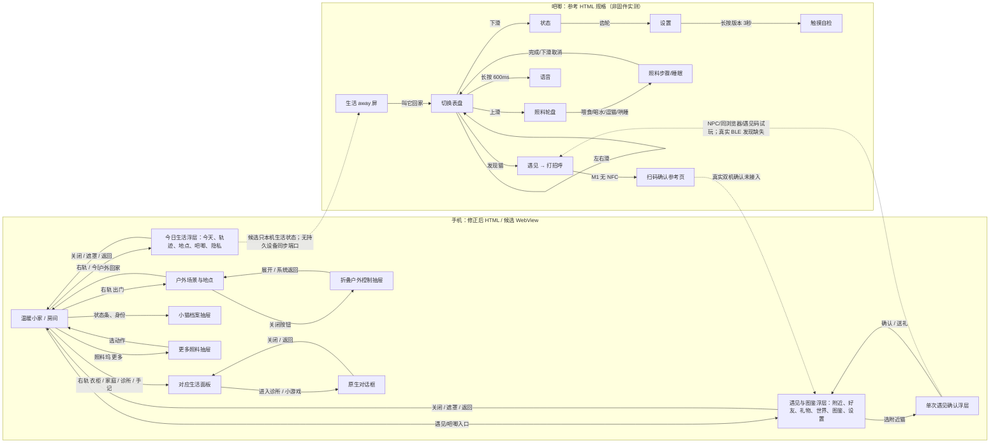

# 猫咪森活交互地图与入口审计

审计范围：当前 `artifacts/html-offline-candidate`，对照根目录修正后的 `小橘电子宠物.html` 与 `吧唧渲染参考.html`。只读源码及既有交付说明；未连接或操作设备、未用真机/ADB 验收。候选 README 也明确说明未完成手机视觉/BLE 验收。HTML 中可点、脚本中有动作，均不等同于设备已通过。

## 重要结论

1. **手机的一级入口并不缺，但入口分散且重复。** 原型有顶部六页导航；窄屏候选把它映射到右侧“出门/衣柜/家庭/诊所/手记”轨、底部五个照料动作加“更多”抽屉。猫身份/状态又能开档案抽屉；“今日生活”从功能轨和生活导航都能打开；社交/图鉴从多个位置打开。抽屉和覆盖层可以叠在不同页面上，关闭语义因页面而异。
2. **关闭模型有来源清楚、但用户可见性不一致的多个层级。** 普通面板/档案/照料用抽屉关闭；户外抽屉的关闭按钮实际折叠/展开，返回家靠手机返回或“回家”按钮；生活、社交、积木工坊、毕业用自定义全屏浮层；改名、接鱼、重置、诊所用原生 `<dialog>`。Android 返回处理顺序在 `offline-host.js` 中明确，但各自可见的关闭按钮文案/位置仍不统一。
3. **用户提到的文字拥挤有代码层面的现实风险。** 今日生活五个 tab 在手机窄宽度下 CSS 为横排 flex、未换行（`life-panels.css`），不能假定能完整显示；卡片正文与复杂详情位于长滚动弹层。候选确实给 dialog 加了视口最大高和 `overflow:auto`，但这只是代码保障，不是手机视觉验收，社交等自定义 overlay 的内部滚动还要分别看其样式。
4. **外出回家已有本机原型动作，社交擦肩礼物闭环没有真实跨设备证据。** “今日生活→今天”外出卡中有“叫它回家”；照料时若检测猫在外，会自动发回家倒计时/反馈；吧唧规格也有 away 页和叫回家按钮。然而手机出门主体还要进“出门走走→户外”，移动抽屉在此常驻为可折叠控制层。候选社交页明确标记 NPC、同机多窗口与遇见码为本地试玩，真实吧唧扫描、双机确认、奖励同步尚未接入。真实擦肩的对猫相遇动画/即时回礼也无可验证设备事件通路。
5. **吧唧参考规格非常完整，但它是可交互的桌面参考/模拟器。** 规格列出 23 个逻辑 screen、触控阈值、上下左右/长按/拖动映射、手机/离线环境限制；“全部画面”列表可直接跳 screen，本身不是实际吧唧流程取证。候选尚未接入吧唧画面、社交事件、同步持久结算。

## 流程图

下方 SVG 是可单独打开的简体中文地图；此 Markdown 中的 Mermaid 是可编辑源。图把用户入口/面板/返回链和设备同步缺口并列；虚线表示模拟/未接接入，不表示通过。

## 结构化入口清单

### 手机端：HTML 基线与候选

| 入口/页面 | 从哪里进 | 返回/关闭与下一步 | 状态影响 / 注意点 | 证据与状态 |
|---|---|---|---|---|
| 温暖小家、房间、五项状态、成长、愿望 | 启动默认页；顶导航“温暖小家”；状态条/猫身份 | 面板回家；状态条/身份开档案；场景内点物品触发照料/互动 | 猫状态、成长、币、愿望可写入本机存档；房间交互触发三维场景 | 原型主页 HTML 行约 174–225；候选 index 保留主体（候选 README）。代码实现；手机像素/触控待验 |
| 六个主生活页 | 原型顶部 nav：家、出门、品种衣柜、诊所、家庭、手记；候选窄屏用右轨五个页，家为底层默认 | 点家回主页；选择另一个页替换当前面板 | 户外切换房间/户外 scene；衣柜、家庭、诊所、手记各有本地玩法或记录 | 原型 `小橘电子宠物.html` 约 181、206–210；候选 `game-04.js` 前 55 行。页面保留；窄屏用户需认知不同导航形态 |
| 六项照料坞 + 更多 | 手机底部固定：喂食、喝水、洗澡、摸摸、睡觉、更多；“更多”抽屉另列猫爬架、逗猫棒、接鱼等 | 轻照料启动后留在场景；长互动有“先休息”取消；抽屉更多的动作入口会自动关闭抽屉 | 照料数值/币/成长写存档；忙碌时收起坞/抽屉以免遮挡 | 原型约 4389–4394、4466+；候选 `game-04.js` 29–50 行。代码逻辑有；需短屏/触点验收 |
| 档案抽屉 | 猫头像/身份、状态条 | 关闭按钮；从其它生活页进档案时先切回家 | 展示统计/成长/愿望等，领取愿望会改存档 | `game-04.js` 51–64 行。入口重复但可理解为同一档案 |
| 户外页面与地点/活动 | 右轨“出门”，顶部原型“出门走走”；户外内地点 tabs、走动/探索/钓鱼等 | 户外抽屉按钮写“收起/展开”，不是关闭；返回处理走 `world-home`；户外页中需找到回家路径 | 选地点/户外行动会改变场景、活动进度/记录；露天地点功能本身不等于生活同步的“在外”状态 | 原型 `world-panel` 及候选 `game-04.js` 15–40 行；顶部“回家”返回实现见 `offline-host.js:163–178`。这是常驻抽屉反馈的直接原因 |
| “叫它回家” | 今日生活→今天的外出卡“叫它回家”；生活同步里房间生活事件；照料动作捕获猫在外时自动回家 | 回家逻辑立即显示 toast/状态更新；不需要进抽屉才能触发，但入口埋在动态外出卡/今日生活/照料旁路 | 本机 `callBack` 30 分钟到期；同步刷新生活模型；一条猫回家 moment/toast；并不证明吧唧状态同步 | 原型约 5998–6005；候选同源 `game-06.js`，候选 DEVICE-CONTRACT 限定未实现 snapshots/events。功能代码在、入口显性不足、硬件联动未做 |
| 今日生活 | 右轨动态插入“生活”；小镇导航新增“今日生活”；社交/首页胶囊可能再开 | 顶栏 ×、点击遮罩、Escape、Android 返回可关；五个横向 tab 切换内容 | 今天/心动轨迹/常去地点/吧唧/授权与隐私；geo/voice/sync 等权限配置默认关闭；明确用户操作才请求 | 根原型约 5753–5825；候选 `game-06.js:675` 起。功能存在；五 tab 在 ≤600px 是 nowrap 横排，易挤/横溢；尚无手机截图验收 |
| 社交/遇见与图鉴总面板 | 今日生活“吧唧”内容里的入口、常驻遇见提示/横幅、好友邀请等脚本触发；部分主 UI 添加状态入口 | 总面板 tabs：附近/好友/礼物/世界/图鉴/设置；独立遇见确认子浮层；先关子层，返回总面板，再关总面板 | NPC、同一浏览器 BroadcastChannel、遇见码会改变本机好友、图鉴卡、礼物、日记、币、世界等 social localStorage。不是实际设备配对/扫描 | 候选 `game-08.js:807–824, 831–838, 858–865, 906+`；`offline-host.js` 会注入试玩说明。注意“功能逻辑完整” ≠ 真实社交 |
| 附近/确认/礼物 | 社交→附近“找找附近的小猫”或扫码/输入遇见码→猫卡“遇见”→确认浮层；好友相遇提示也可达 | 确认层 X/遮罩/系统返回；成功后结果页“完成/去拆礼物/看好友”；收礼在社交→礼物拆开 | 代码本地规则可以创建好友、交换图鉴卡、准备/收/拆礼、给本机存档奖励。附近 NPC 是定时生成、RSSI 模拟；“air”是同源 BroadcastChannel；遇见码在本机校验 | 候选 `game-08.js:242+、296–304、435–483、533–560`。实擦肩→双方动画/可靠礼物交换未完成；当前动画只在 HTML 本地单机流程 |
| 衣柜、家庭、诊所、手记 | 右轨或六页 nav；家庭内可孵化/领养/毕业/谱系；诊所页面内开检查弹层 | 选择新主页；诊所完成回家；毕业卡可开逐步仪式 overlay | 衣柜改外观；家庭改 roster/孵化进度；诊疗改健康；手记追加日志；毕业写档案/谱系 | 原型约 207–210、诊所 dialog 238–242，毕业脚本约 4735–4836。多入口但 page identity 清晰 |
| 设置/权限/隐私 | 今日生活→授权与隐私；社交总面板→设置；每个社交 profile 内部另有拉黑举报/联系设置 | 同所属大浮层关闭；子操作可能调用 JS confirm/prompt | 配置位置发现、遇见、数据记录、敏感权限；初始化默认关闭；设置分布在两个面板，容易误以为同一套 | 原型 5755、社交 tabs `game-08.js:809+`。重复“设置”标签语义不同，需注明分别控制生活与遇见 |
| 存档 / 改名 / 小游戏 / 重置 | header 存档菜单；猫名铅笔；玩法按钮； | HTML dialog 的 X/取消/提交；系统 back 从最后打开 dialog 关闭 | 导入/导出存档；小游戏奖励；重置会替换整个家庭与状态 | 原型约 164–168、dialog 231–242；候选 index 保留 dialog；候选 Android Back 逐层按 `offline-host.js:163–178`。代码约束较好，视觉待验 |
| 积木场景工坊 / 毕业仪式 / 临时事件 | 户外地点的工坊按钮/场景特定入口；家庭毕业卡；户外事件或社交横幅 | 各自 overlay 的独立 X、遮罩或 Escape；积木/毕业可能内部多步 | 房屋放置/搭建/毕业步骤写家庭或场景存档；事件选择写结果；关闭中断未完成步骤 | 原型 `game-07.js`、毕业 `game-05.js`、活动/事件 `game-03.js`。较深层入口、遮罩关法与 X 位置需一致化 |
| 我的吧唧 / 设备测试连接 | 今日生活→吧唧 tab 或相关设备入口，明确按钮打开连接页 | 连接弹层/页面内按钮关闭；Android Back 关闭 custom dialog | 按钮按下后申请必要蓝牙权限/扫描。initialize 不自动连；HELLO + GET_STATE + ACK 等条件后才可说本地控制就绪 | 候选 `DEVICE-CONTRACT.md`；`offline-host.js` 163–178、设备入口在连接器逻辑。无同步/事件/好友端口；当前不操作设备 |

### 吧唧端：参考 HTML 规格（逻辑 screen 与路径）

参考规定：主屏只有猫；轻点≤300ms、移动<12px；长按600ms；滑动≥50px且≤500ms；二级下滑返回；睡觉按住月亮1.5秒；逗猫是拖动。参考屏列表能直接跳转供审阅，表中“真实路径”按 SPEC 的 `enter/exit/act`，不把屏列表点击当产品入口。

| 画面 | 进屏 | 返回/路径 | 状态影响 | 当前与基线差异 |
|---|---|---|---|---|
| 开机 `boot` / 配对 `pair` / 首次引导 `guide` | 开机按是否配对进入；首次 BLE 配对成功进入 5 页引导 | 引导逐屏轻点，最后到表盘；参考写 App 扫码/输入 6 位码，候选没完成连接与引导内容映射 | 建立绑定/引导状态 | HTML SPEC 与桌面模拟器；实际固件不是本审计验证对象 |
| 主表盘 A/B/C `main_a/b/c` | 引导完成、其它页面返回、待机唤醒 | 左右滑切 3 表盘；上滑照料；下滑状态；点猫摸摸；长按说话 | 表盘状态、轻触加心情 | 需求提到表盘只有同猫/切换无差别反馈；SPEC 的 B/C 明确加 24h 时间环与心动标记，但本候选手机不承载吧唧渲染 |
| 待机/息屏 `aod/off`、低电 `lowbat` | 无操作进入、常显设置或电量<5% | 抬腕/轻点/唤醒词回主屏；插电离开 lowbat | 省电、唤醒、电量反馈 | SPEC 明确；IMU/真机唤醒仍待硬件验收 |
| 状态 `status`、设置 `settings`、触摸自检 `touch_test` | 主屏下滑；状态中点齿轮；设置底部版本长按3秒 | 状态上滑回表盘；设置右滑回状态；自检点完 5 靶自动设置页，右滑返回 | 状态行可跳至照料；设置亮度、唤醒、发现、常显；自检改触摸验证而非玩法数据 | REF 文字清楚；参考说明里手势线索在屏内，避免隐形手势依赖。实际字库问题需要固件实测确认 |
| 照料轮盘 `care_menu` / 喂食喝水 `care_feed/water` | 主屏上滑/提示/语音，点轮盘按钮 | 喂食/喝水三次完成回主屏；下滑取消且不扣款不加成长 | App 为正式规则结算；完成事件上行；进度与单次值变化 | 吧唧仅 4 类轻照料；不是手机端全功能照料坞 |
| 逗猫 `care_play`、哄睡 `care_sleep/sleeping` | 轮盘或离线命令词 | 逗猫扑 5 次/超时取消；哄睡按月亮1.5秒、6秒后醒；下滑取消 | 完成上行事件、心情/精力/成长结算；取消无结算 | SPEC 定义精确动作，但候选没接吧唧事件持久化端口 |
| 语音 `voice` | 主屏长按、唤醒词、语音入口 | 松手/静音结束→识别命令→动作后回主屏；未连手机时只响应支持词 | 摸摸/照料/状态/换脸/回复等事件 | 规格状态；候选明确语音权限默认关闭，且入后台取消监听 |
| 遇见 `meet` → `meet_tap`/`meet_scan` → `meet_done` | 附近吧唧发现→遇见屏→打招呼；M1无NFC走扫码确认 | 忽略/取消/超时返回；确认后成为朋友页约4秒回表盘 | EVT_MEET 上行，礼物/好友结果经手机校验 | REF 需求中的设备扫描、确认协议/礼物真结算没实现；手机本地遇见码/NPC不能补足 |
| 外出 `away` | 与手机行程场景联动 | “叫它回家”回主表盘（30分钟）；倒计时后可再外出 | 行程画面展示地点与生活状态 | 仅有 phone HTML 原型规则及 SPEC；候选设备 contract 没有 snapshots/events，不能跨端触发 |

## 返回、手势、叠层层级

- **手机窄屏**：场景/当前 `data-view` →（可叠）`m-sheet` 抽屉 →（可叠）独立 overlay 或 `<dialog>`。普通 panel 关 sheet 时回 `home`；`world` sheet 上的 X 只切“收起/展开”；社交确认须先关 `#sc-meet` 回 `#sc-hub`，再关总面板。Android Back 处理顺序可在候选 `offline-host.js` 看到：meet → 最后一个原生 dialog → 社交/积木/生活/毕业/外出 overlay → sheet → 中断忙碌交互 → world 回家 → 退出 Activity。
- **手机手势**：滚动的生活/社交长内容使用纵向滚动；户外 canvas 保留触摸手势，照料 canvas 独占玩法手势；关闭/返回主要是按钮/遮罩/系统返回，不应让横滑误当返回。涉及遇见节奏、长按等动作都应局部消费，避免滑动串到房间。
- **吧唧参考**：主屏左右换表盘、上滑照料、下滑状态，二级上/右滑按画面返回规则；不是统一“下滑关闭”：设置要求右滑，触摸自检同样右滑；照料取消用下滑。主屏长按说话，睡眠长按按钮、触摸自检长按固件版本，三处长按时长不同。
- **设置语义重名**：`今日生活→授权与隐私`管理 life collection；`遇见与图鉴→设置`管理 discover/Fate/联系方式；吧唧 `status→gear→settings`只管理亮度、唤醒、附近发现、常显。手机“吧唧”tab本身也同时展示表盘时间环预览与连接状态/生活时间环。

## 与用户已反馈问题的代码证据

- **tab 到第二排/不易看全**：根 HTML `#life-ov` 由五个 tab 横排；候选 `life-panels.css` 定义 `.lf-tabs{display:flex;...overflow-x:auto;}`、`.lf-tabs button{white-space:nowrap}`（根源码约 4965–4967），不换行；小屏下设计目标是横向滚动。故“第二排”需视具体实际运行截图确定；代码显示存在横向溢出/部分 tab 隐藏风险，不证明设备实际断行。
- **长文本弹窗溢出**：候选普通 `<dialog>` 有 `max-height:calc(100dvh - 32px); overflow:auto`（index.html 行19），弹窗自身有滚动保护；但 `life-ov/sc-ov/bk-ov/grad-ov` 是自定义 overlay，要检查各自 box 的 max-height 与 flex 子项 `min-height:0`。目前仅凭源码不能断言所有手机像素都溢出，也不能宣称已修好。
- **回家入口与外出抽屉常驻**：`game-04.js:17–35` 明确 world 模式 backdrop 不开，sheet X toggle collapsed，close 只用于普通 panel；系统返回单独通过 `world-home` 退回。今日生活外出卡的 `data-back` 是更直接回猫途径。视觉上常驻符合可折叠 world 控件模式，但用户未必会把“收起”理解为离开；更明显的户外“回家”可达性仍是风险。
- **吧唧图标变纯文字/表盘重复**：参考屏幕 spec 把功能放为 16x16 图标、3D 猫；表盘 B/C 有不同时间环内容。候选没有吧唧 renderer UI 连接或设备画面接入，因此网页 UI 的文字按钮不能视作固件图标问题已修复，候选端也没有表盘交互可验。
- **引导结束空白、设置缺字**：参考 `guide` 最后一页应该点击回主表盘，`settings`中文短行及字库表作为规格；若固件当前出现空白/缺字，这是固件绘制或字库构建的实机问题。本审计没有固件运行事实，也不能从参考 HTML 宣称缺陷已消失；候选手机无该吧唧首启/设置屏。
- **擦肩礼物视觉闭环**：候选 local UI 的礼物 tab 有“朋友带来的礼物”卡、“拆开”按钮和开盒类名 `opening`/750ms 延时结果反馈（game-08.js:858–862、915），属于手机 CSS 模拟开盒体验；近场生成来源 NPC/同浏览器 BroadcastChannel/遇见码，设备 scan/events缺失。没有双方真实擦肩触发→两只猫屏幕相遇→即时礼物动画→奖励确权的路径。

## 最多五项改造建议（按影响排序）

| # | 建议 | 证据/验收边界 |
|---|---|---|
| 1 | 把“在外 / 回家”设为一个可见、常驻且文案统一的状态动作：户外显示主按钮“带小猫回家”，将“收起”限于抽屉折叠；今日生活外出卡只做同一动作的另一入口。明确标记这是手机本地回家状态。 | 现有 world-sheet X 是收起/展开、Back 才退出；`data-back` 入口藏在动态卡。改后静态检查所有状态可达，并做手机窄屏触控/返回验证；无真机同步声称。 |
| 2 | 为每层定义唯一标题/关闭图标/层级规则，社交确认→社交 hub→基页逐级退；自定义 overlay 与原生 dialog 的关闭按钮、遮罩和系统返回对齐；确认类不可逆操作保留二次确认。 | 多套 overlay 及 Back handler 已存在；关闭语义有 X、完成、收起、返回/遮罩混用。验收矩阵覆盖每个 overlay 的 X、遮罩、Android Back/Escape 及是否恢复底页。 |
| 3 | 今日生活 tab 改成有明确“横向可滑”提示/渐隐或改两行响应式 tab；长内容 overlay header 固定、body 单独滚动，并显式给未展开内容可达提示。 | `life-panels.css` 使用 nowrap 横向滚动；dialog CSS 只保护原生 dialog。用 360×640/390×844 与大字跑像素截图、检查 tab 最后一项/弹窗末尾关闭和正文可达。 |
| 4 | 将“功能模拟”和“设备实连”在 UI 入口级区分：NPC/同机/遇见码旁就地标识；把“吧唧已连”拆成“本地控制已确认”与“生活/社交同步未接入”，断连/不兼容协议给明确状态。 | offline-host 注入试玩声明；DEVICE-CONTRACT 表明只有基础控制，snapshots/events/encounters 缺省。验收需通过真实设备测试窗口，不以 fixture、NPC 或网页截图代替。 |
| 5 | 在设备/协议有正式端口后，再实现并验收真实擦肩闭环：双方 discovery → consent/confirm → 双设备动画与礼物一致性 → 重放/断连恢复 → 仅一次奖励持久化。 | 现在社交逻辑本机 localStorage，air 是 BroadcastChannel，NPC 随机模拟；吧唧参考的 EVT_MEET 也只是规范；候选设备端口缺失。未获得设备/协议证据前不得把现有玩法动画宣传为硬件闭环。 |

## Mermaid 源之外的直接代码索引

- 手机 shell、原生 dialogs：`artifacts/html-offline-candidate/source/android/app/src/main/assets/index.html`（尤其行 157–265）。
- 手机 sheet/主入口映射：`.../assets/game-04.js`（开头至约 70 行）。
- 今日生活与“回家”：`.../assets/game-06.js`（tab 构建、外出卡及 `data-back` 事件）；根源相同序列约 5753–6005 行。
- 社交总面板、遇见、好友/礼物/图鉴/设置：`.../assets/game-08.js`（入口约 242、296、807、817 行；NPC/广播逻辑约 254 行；奖励逻辑约 435–483 行）。
- 分层返回与设备边界：`.../assets/offline-host.js`（163–201 行）、`.../assets/legacy-bj20-adapter.js`、候选 `DEVICE-CONTRACT.md`。
- 需求参考与手势规格：根 `小橘电子宠物.html`、`吧唧渲染参考.html`；吧唧页面包含 SPEC screen 定义、手势判定及 `swipe()` 路由。
- 设备验收/自动测试边界：`artifacts/html-offline-candidate/README.md` 与 `HANDOFF.md`；目录内的 DOM/fixture 证据不是手机像素或实际 GATT/社交设备证据。

## 审计结论

当前候选适合作为有大量本地入口的离线手机玩法候选和吧唧基础控制接入壳；其主要交互负担来自入口分散、抽屉/浮层关闭语义不同、设置按主题分属多个面板。用户反馈与源码表明布局风险点确实存在，需要手机屏幕/大字视觉验收后精修。手机本地外出/回家玩法已有规则路径但不够显眼；吧唧联动与“真实擦肩遇见 + 双边礼物动画/奖励”是明确未完成的产品闭环。任何修复、安装或联设备工作应由主会话/指定实现线程决策；本报告没有修改实现。
