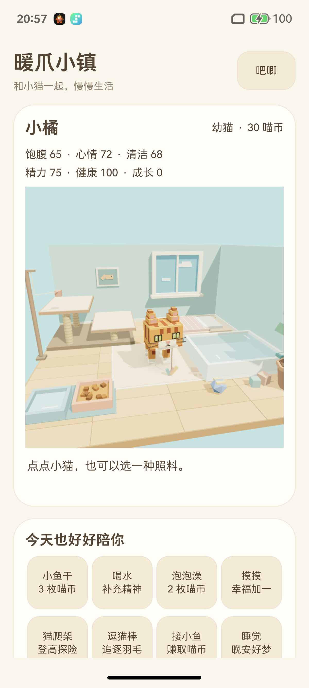

# 沉浸房间首屏：真机截图与原相机独立审查

2026-10-15。只读审查用户当前真机截图和既有源码；未构建、ADB、串口、设备或产品修改。未接触吧唧备份。使用Product Design audit技能；其preflight未发现已存上下文。沿用用户明确提供的这张当前截图，不借旧模拟器画面描述真机。

## 1. 当前真机首屏：结构不合格，真实资产已加载

截图原件：`artifacts/device-integration/2026-10-15T1245Z/phone-launch/launch.png`，1200×2670；本目录保存逐字相同副本，SHA-256 `a73b9fe7d2d15f25d21f758b10a1bf8322017b5e0534fccd9c47953b387b31c2`。root报告安装来源为冻结a73候选、StepX/API36；本人未重新读取设备安装信息。

**截图确认：** 原3D橘猫、房间、猫爬架、食/水碗、浴盆和床等资产已呈现。主要问题是入口空间分配，不需要换模型或增加新页面。

| 截图发现 | 证据位置/近似量测 | 最少调整 |
|---|---|---|
| 房间成为统计卡里的小图 | 原图画布约x98..1101、y724..1739；宽约84%屏宽、高38%屏高、面积约32%整屏。数值按当前截图人工近似定位，不是运行时bounds | WebView放root FrameLayout充满首屏，去掉首屏ScrollView/外卡padding/圆角裁框 |
| 猫的表演不主导首屏 | 猫体约屏高8–9%，动作只能在中部小窗看；画布顶还有较大空墙区域 | 针对新的实际portrait viewport重新取景；猫+可交互房间成为视觉主体 |
| 大标题和完整统计抢上半屏 | “暖爪小镇”、副标题、名字/币/6项统计在画布之前形成文档层级 | 名字/阶段/币并成紧凑顶部HUD，详细数值点开，不默认多行统计卡 |
| 8照料按钮继续形成第二张长卡 | 底部只见首行/部分次行，需要滚动；场景家具本可点击却未成为主要入口 | 直接点猫与家具；底部保留少量游戏入口，照料全集及次要管理进抽屉 |

画面色彩与真实像素模型可以保留。需要调整的是“打开即进入房间”的层级，不能把同一统计卡铺大后仍要求上下滚动。

## 2. 原HTML房间viewport与相机：不能只CSS拉长

来源为根目录未改动`小橘电子宠物.html`（SHA `3e1b68b6dcef89ce6003961e0abb41354785443bd0427b83ed70f7589fd8af53`），第三段inline script `bf`。原`.room`本身是564px高的网页容器；其真实渲染器支持resize，但原页面布局不是本次沉浸首屏目标。

- `bf.Uo()`从container的`getBoundingClientRect()`读取真实宽高，执行renderer.setSize(width,height,false)，更新camera.aspect、fov和projectionMatrix。ResizeObserver监听container。
- portrait分界aspect<1.12：相机位置(8,24,−43)，OrbitControls target(0,8.5,1.5)；宽布局位置(10,29,−58)。同一分支resize不会每帧重置用户视角。
- portrait的垂直FOV是`2*atan(tan(horizontalFov/2)/aspect)`；aspect<.62取水平50°，否则60°；宽布局垂直39°。当前近方形画布aspect≈1，对应垂直约60°。直接换成1200/2670≈.449全屏后，原规则垂直FOV约**92.1°**。系统insets/实际viewport会略改该数值。
- 仅改canvas CSS高度或transform scale会与真实drawing buffer/相机、raycaster的DOM rect脱节；仅固定垂直FOV则可能裁掉左右食/水碗、浴盆、爬架。都不能作为已正确适配。
- OrbitControls原限制：distance42..72、polar .85..1.32、azimuth2.48..3.5，禁pan/开zoom；canvas曾设touchAction=pan-y。去掉外ScrollView后需核对触摸策略，不能继续把房间手势作为页面纵向滚动。

**最小相机方案：** 只在真实viewport稳定/尺寸变化时，按已有模型和家具投影进行portrait构图；先用原相机/target作起点，调整距离、target高度与FOV，使关键物件投影落入HUD以外的safe rect。不要改变模型比例/世界坐标来假装更大，不需要新相机系统或跟随玩法。保留受限观察/缩放时提供“回到小家视角”，交互开始必要时回安全构图，不能每帧和用户抢镜头。

## 3. 三处最少结构改动

1. **Native根层换满屏场景。** root FrameLayout内WebView MATCH_PARENT；安全区内顶部一行轻HUD，底部一个紧凑dock。状态栏/挖孔/导航区域用真实WindowInsets；场景可以延伸其后，按钮不能落入遮挡区。首屏没有纵向页面滚动。
2. **辅助信息收进可关闭抽屉。** 名字/阶段/币、一个轻量需求提示留在场景边缘；详细6状态、完整照料列表、愿望、背包/衣柜、吧唧/设置保持现功能入口但默认折叠。按原实现方法调用，不改存档/费用。开始实际照料前收起抽屉露出房间；进行中只保留必要进度与取消，不用整块面板挡猫。
3. **真实家具就是动作入口。** 原`bf.Oi()`已有home-food→feed、home-water→drink、home-bath→bath、home-climb→climb、home-feather→tease、home-bed→sleep，另有onPet。复用当前onAction/onPet→Native预检→原startInteraction→完成保存的路径；不能直接perform就加奖励。接鱼/出游等没有相应房间物件的入口留在底dock/抽屉，不在房内画伪道具。

原`rc()`按实际canvas.getBoundingClientRect()做raycaster；新布局必须继续使用同一个真实viewport。HUD只在按钮自身消费触摸，透明空白不能用一个全屏可点击native父层截走猫/家具输入。照料drawer内保留有名称的可访问替代入口，不能因改为物件触摸而失去无障碍操作。

## 4. 首版验收门槛（建议目标，不伪称PRD原定数值）

以下先在同一StepX/1200×2670及新APK完整SHA取证，原猫/存档原位保留；若界面结构改变必是新候选，冻结a73目录不修改。

| 门槛 | 可复核要求 |
|---|---|
| G1 场景主导 | WebView真实布局充满应用窗口；首屏至少90%应用面积为连续房间背景，无独立内容卡/页面滚动。HUD关闭抽屉时，未被不透明面板遮挡的场景至少80%应用面积 |
| G2 猫可见且值得看 | 默认幼猫站立全身约12–18%可用屏高作为首版调优目标；脸、双眼、耳、脚不被HUD遮住。不能为达到比例裁掉关键物件；成年/动作最高点另验不裁切 |
| G3 房间可玩 | 默认安全构图中食碗、水碗、浴盆、爬架第一目标、羽毛区域、床都能识别和点中；投影在挖孔/上下HUD以外。若需受限视角才可见，必须有明确可达/复位方式，不能藏在屏外 |
| G4 对象入口真实 | 实际点猫、食/水/浴盆/爬架/羽毛/床分别触发正确预检和原动作。feed三口、drink三次、tease五次及bath/climb全阶段不被HUD挡；触点不能发生双重Native action |
| G5 HUD轻量 | 默认最多顶部紧凑状态行、底部少量入口及短反馈；不常驻大标题/6项全统计/8按钮。文字不遮脸，反馈跟随真实事务；展开drawer有明确关闭/返回，收起恢复同房间 |
| G6 交互期间安全 | 开始/完成/取消/失败状态仍清楚；进度与取消在insets安全区且至少48dp触摸目标；drawer/返回/后台不发假成功、不让旧回调落到新场景。短反馈不能盖食碗/水碗/洗澡rub/羽毛目标 |
| G7 真实resize | 新frame实际canvas像素比和camera.aspect与DOM真实宽高一致；无拉伸猫、错误raycaster位置或CSS裁切。键盘/系统栏恢复、前后台、设备旋转政策下尺寸稳定；不因重排重播/重建奖励 |
| G8 两份动态证据 | 新SHA录：①冷启静置→点猫→打开/关闭辅助抽屉→视角复位；②点食碗→三口真实输入→保存反馈→返回全景，再一次取消。两段均附before/after存档，确认身份/费用/计数正确 |

优先只实现并验G1..G8这一个首屏闭环，不拓展其他页面、模型、剧情或新经济规则。其余事件完整视觉矩阵仍按`tests/event-matrix/coverage.md`保留。

## 5. 本次审查步骤与限度

1. **当前真机首屏：不合格。** 已打开并检查提供的截图；主体被卡片与文档布局压缩，资产本身真实存在。
2. **原renderer与交互映射：可复用。** 源码确认resize/FOV/受限Orbit和真实家具hit入口；新全屏相机/点击效果尚未渲染验证。
3. **新沉浸首屏：待实现与真机验收。** 本报告仅建议最小改动和门槛；没有新APK、操作设备、动画或无障碍实测结论。

单张截图不能证明帧率、触点、遮挡全过程、TalkBack焦点或后台恢复。可访问标签/48dp与低动效需要运行确认；现有截图的字号/颜色也不足以声称完整可访问性合格。
